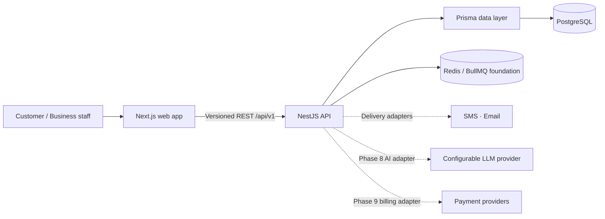

<div align="center">
  
  <h1>GharSync</h1>
  <p><strong>Your Home. Your Services. One Platform.</strong></p>
  <p>Pakistan-first home care and service-business operations, built to grow from one home to a connected service network.</p>
</div>

<p align="center">
  
  
  
  
  
</p>

## What is GharSync?

GharSync brings customers, home assets, local service professionals and business operations into one platform. The product is being developed in phases, with tenant-aware data boundaries and modular feature ownership from the start.

Phases 1–3 provide the responsive public/auth experience, organization and session foundations, and the first business console with a database-backed dashboard and customer CRM. Feature work continues in reviewable product phases; booking, billing, inventory and other modules remain on the roadmap.

## Product direction

- **For homes:** Keep properties, appliances, service history, warranties and maintenance requests together.
- **For service teams:** Manage customers, branches, bookings, technicians, quotes, invoices and stock.
- **For the platform:** Support multiple organizations with server-enforced permissions and tenant isolation.
- **Pakistan first:** PKR currency and `Asia/Karachi` timezone defaults, with room for international expansion.

## Architecture



```text
apps/
  web/                 Next.js App Router screens and UI
  api/                 NestJS versioned API and Prisma schema
packages/
  shared-types/        API envelopes and cross-app domain types
  validation/          Shared Zod request schemas
  config/              Reserved for agreed shared tooling presets
docs/
  DEVELOPMENT_PHASES.md Team plan, phase boundaries and status
  database/            Data model decisions and migration notes
```

Web screens belong in route folders under `apps/web/src/app`; reusable UI belongs in `apps/web/src/components`. API modules own their DTOs, services, authorization checks and persistence calls. Shared contracts live in `packages/`, and frontend code never accesses the database directly.

## Local development

### Requirements

- Node.js 22.22.3+ or 24.15.0+ (required by the NestJS 12 CLI toolchain)
- npm 10 or newer
- Docker Desktop or Docker Engine with Compose

### Start

```bash
cp .env.example .env
npm install
npm run infra:up
npm run db:generate
npm run db:migrate
npm run db:seed
npm run dev:web
```

In a second terminal, start the API:

```bash
npm run dev:api
```

- Web app: <http://localhost:3000>
- API health: <http://localhost:4000/api/v1/health>
- PostgreSQL: `localhost:5432`
- Redis: `localhost:6379`

The checked-in Prisma migrations are applied when the local PostgreSQL database is available. Run the seed command to install/update the role permission catalog; it does not insert fake customer or booking records. Phase 4 adds customer properties, appliance/assets, service history, private QR entry and private document uploads. Phase 5 adds a branch-aware service catalog, booking assignment and status history, quote revisions/decisions, invoice PDF output, pending/verified payment receipts and auditable manual refunds. Customer quote decisions are recorded by staff; homeowner login/notifications and payment gateway settlement are future integrations. Local document files are stored under `var/documents` by default (or `DOCUMENT_STORAGE_PATH`) and need persistent storage and backups in deployment. API authentication requires three independent secrets in `.env`; generate them with `openssl rand -base64 48`. SMS verification requires a compatible SMS provider. Password recovery and email invitations require a configured email provider. Provider adapters expect a POST JSON endpoint using a Bearer key; adjust the adapter if your provider uses another contract.

### Useful commands

| Command | Purpose |
|---|---|
| `npm run dev:web` | Start the Next.js app |
| `npm run dev:api` | Start the NestJS API in watch mode |
| `npm run build:web` | Build the web app |
| `npm run build:api` | Build the API |
| `npm run typecheck` | Type-check configured workspaces |
| `npm test` | Run configured workspace unit tests |
| `npm run infra:up` | Start local PostgreSQL and Redis |
| `npm run infra:down` | Stop local services (keeps named volumes) |
| `npm run db:generate` | Generate Prisma Client |
| `npm run db:migrate` | Create/apply a local Prisma migration |

## Environment and secrets

Copy `.env.example` to `.env`, generate distinct values for `JWT_ACCESS_SECRET`, `JWT_REFRESH_SECRET` and `OTP_HMAC_SECRET`, and configure SMS/email adapters when enabling those flows. The checked-in example contains local-only development defaults. Never use those values outside a developer machine and never commit real credentials.

## Security and data rules

- Treat organization and branch IDs from clients as untrusted input.
- Enforce tenant and role permissions in API guards/services and every scoped query.
- Keep audit/event history for security-sensitive and workflow state changes.
- Model money as PostgreSQL `Decimal`, with currency stored explicitly.
- Do not mark invoices paid without a verified payment record.
- Do not claim delivery for a message until a provider confirms it.
- Keep provider credentials on the server and validate webhook signatures.

## Delivery phases

See [the development phase plan](docs/DEVELOPMENT_PHASES.md) for scope, team ownership and exit criteria. Phases 1–3 are implemented in code. Database migration application and provider setup are pending local environment readiness; later workflow phases can proceed against reviewed shared contracts and schema ownership.

## License

Proprietary — GharSync. All rights reserved.
