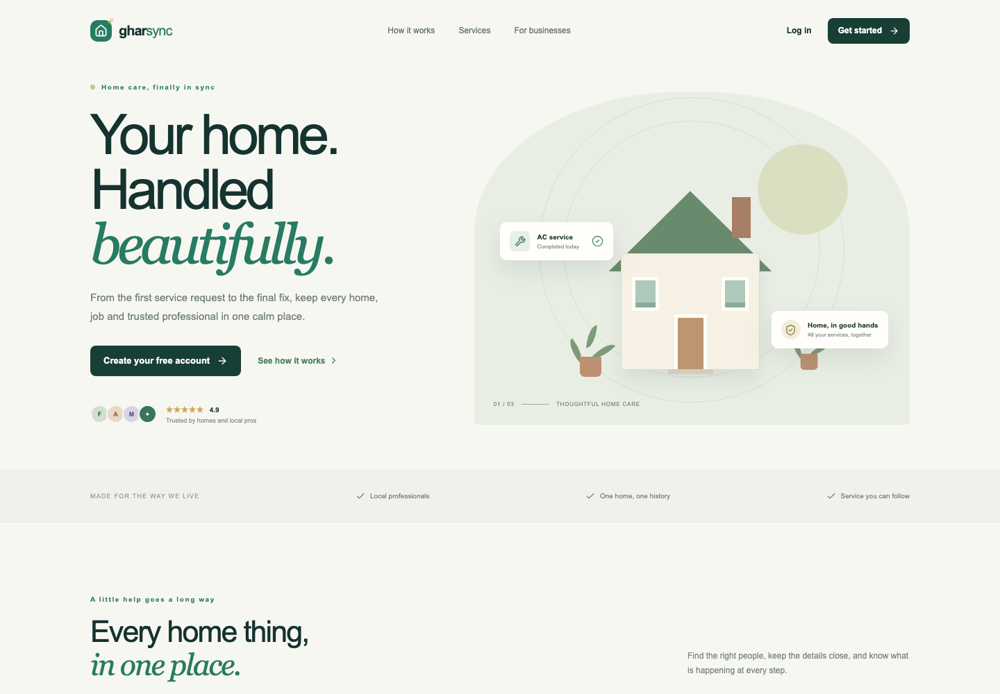
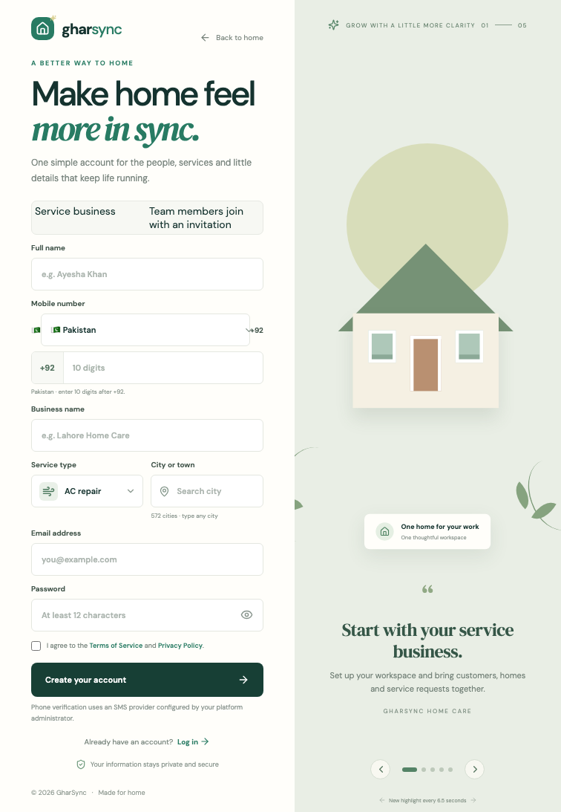
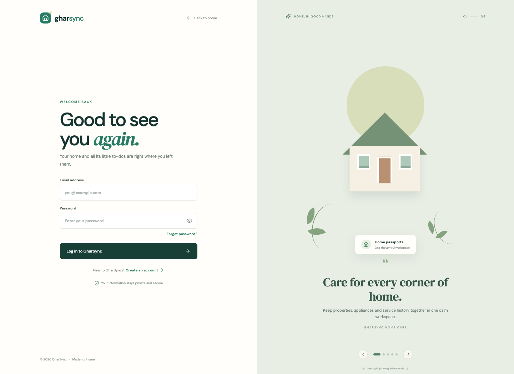
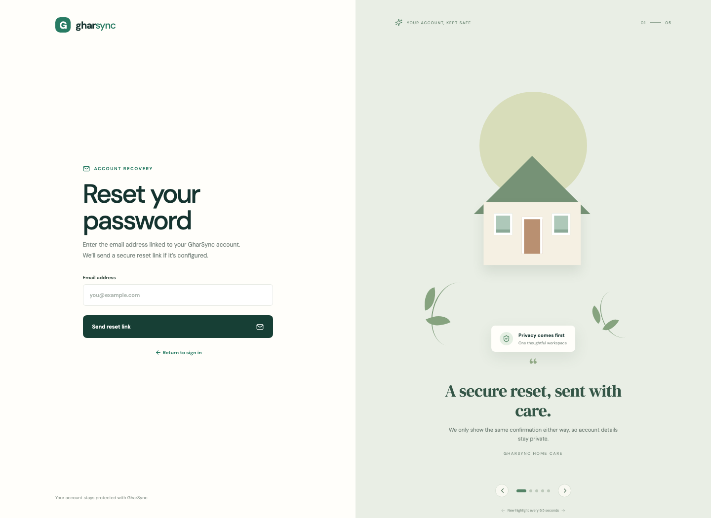
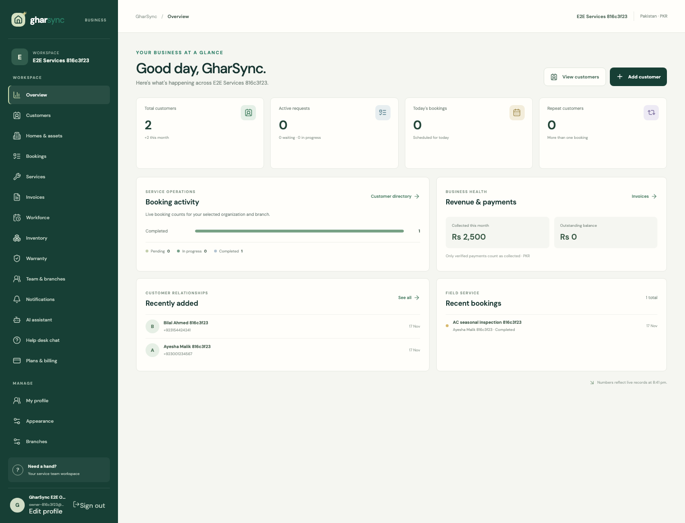
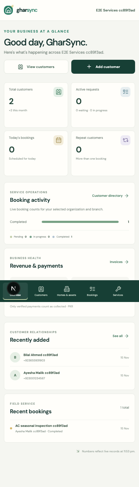
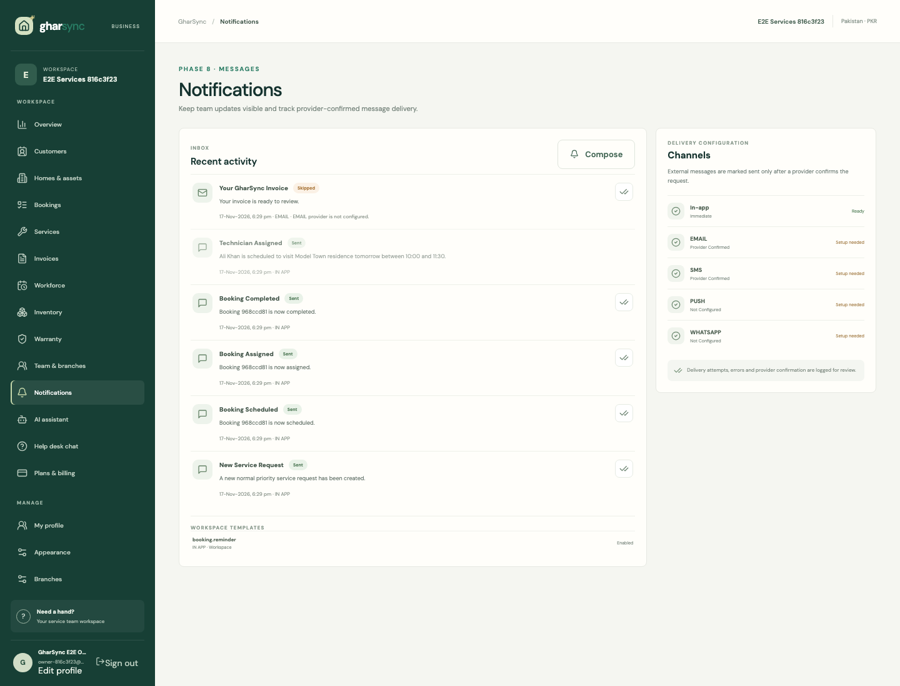
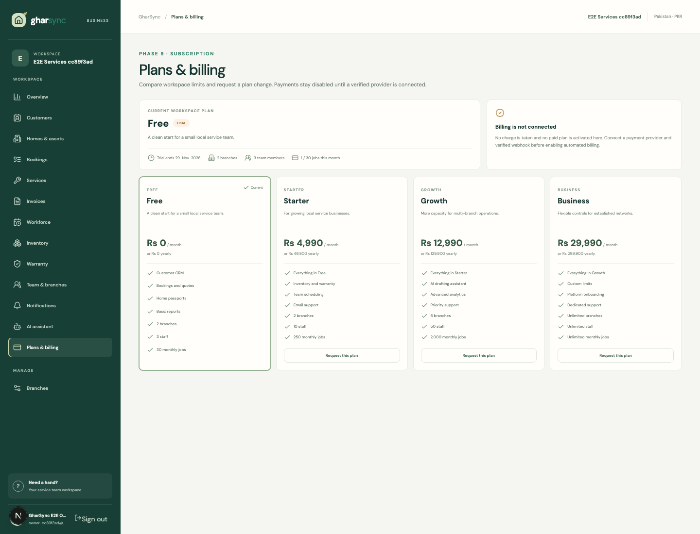
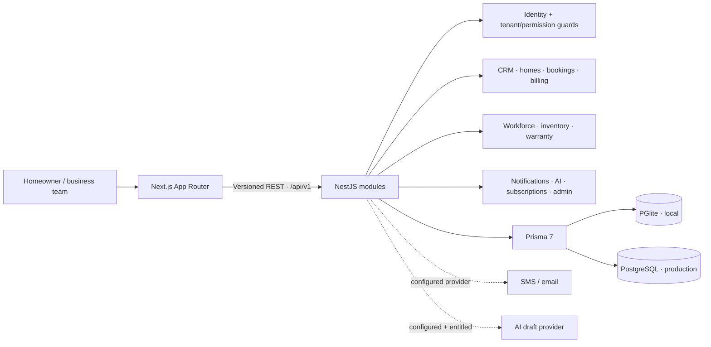

<div align="center">
  
  <h1>GharSync</h1>
  <p><strong>Your Home. Your Services. One Platform.</strong></p>
  <p>Home care and field-service operations, organized around homes, local teams and trusted service history.</p>
</div>

<p align="center">
  
  
  
  
  
</p>

## Product

GharSync is a Pakistan-first workspace for home-service businesses. It connects customer and property records with bookings, technicians, quotations, invoices, stock, warranty follow-up and communication history. Businesses operate in tenant-scoped organizations and branches, with permissions enforced by the API.

- **For homeowners:** home passports for properties, appliances, service records and warranties.
- **For service teams:** customer management, job scheduling, workforce profiles, branch stock, quotations and payment verification.
- **For operators:** workspace plans and usage limits, a protected platform console, support queue and audited configuration.
- **Defaults:** PKR, `Asia/Karachi`, English UI with Urdu-capable text workflows.
- **Signup locations:** all 249 country/territory options with flags and offline country-specific city suggestions; any city can also be typed. See [location data and attribution](docs/data/README.md).

## Current UI

These screenshots are captured from the running web app in Chrome. Authenticated screens use a local development workspace.

| Screen | Preview |
|---|---|
| Public home |  |
| Sign up |  |
| Sign in |  |
| Password recovery |  |
| Business dashboard |  |
| Business dashboard · mobile |  |
| Notifications |  |
| Plans and billing |  |

## Delivery status

| Phase | Delivered |
|---|---|
| 1 · Foundation | Strict TypeScript monorepo, shared Zod contracts, Prisma model, versioned API, responsive brand and persistent Docker-free local database. |
| 2 · Identity | Signup/sign-in, OTP verification, password recovery, rotating refresh sessions, invitations, organization and branch membership, role permissions and audit records. |
| 3 · Business and CRM | Tenant-scoped dashboard, customer search/list/profile, archive and activity. |
| 4 · Homes and assets | Properties, appliances, warranty details, QR access, private documents and service history. |
| 5 · Service workflows | Branch-aware catalog and service-area data, booking transitions, scheduling, assignment, quote revisions, invoices, verified payments and refunds. |
| 6 · Workforce | Technician profiles, skills, weekly availability, leave requests and job-conflict checks. |
| 7 · Inventory and warranty | Detailed spare-parts catalog, suppliers, branch counts, stock receipt/reservation/consumption/transfer, warranty claims and expiry alerts. |
| 8 · Communications and AI | Workspace templates, event-driven in-app updates, provider delivery log, configuration states, redacted text assistance, catalog-grounded quote notes and AI usage audit. |
| 9 · SaaS and platform admin | PKR plans and trials, branch/staff/job entitlements, plan requests, protected allowlist console, organization review, support tickets, feature flags, read-only user/audit views and plan configuration. |
| 10 · Release readiness | CI workflow, unit and end-to-end checks, liveness/readiness endpoints, SEO metadata, sitemap/robots, responsive review, accessibility focus/reduced-motion improvements and deployment/backup runbook. |

Production payment processing and automated SMS/email remain integrations requiring provider credentials. Paid plan changes are recorded as support requests; the app does not claim to charge a card or activate a paid plan. The deployment checklist is in [docs/deployment/README.md](docs/deployment/README.md).

## Architecture



```text
apps/web/src/app/       Route-owned screens: dashboard, CRM, homes, bookings, operations, platform
apps/web/src/components Reusable UI, forms and focused screen panels
apps/api/src/           Nest feature modules, guards, services and workflow logic
apps/api/prisma/        Normalized schema and ordered SQL migrations
packages/validation/    Shared strict Zod request/response input contracts
packages/shared-types/  Cross-app API envelopes and domain types
docs/                   Phase ownership, data choices, screenshots and deployment runbook
scripts/                One-command local startup, demo data and end-to-end checks
.vscode/tasks.json      Start/validate actions from VS Code
```

Each API module owns its controller, service, input validation and data access. UI components call versioned APIs and never access Prisma directly. Organization/branch filters and role/permission checks live on the server.

## Start locally in VS Code — no Docker required

### Requirements

- Node.js **22.22.3+** or **24.15.0+**
- npm 10+
- Docker, PostgreSQL and Redis are not needed for local development

### Run both apps

```bash
cp .env.example .env
npm install
npm run db:generate
npm run dev:all
```

Or open the VS Code Command Palette → **Tasks: Run Task** → **GharSync: Start web + API**.

- Web: <http://localhost:3000>
- API liveness: <http://localhost:4000/api/v1/health>
- API readiness/database: <http://localhost:4000/api/v1/health/ready>
- Stop: press `Ctrl+C` in the VS Code terminal.

The API starts PGlite inside Node and persists data under `var/pglite`. It applies checked-in SQL migrations and seeds permission and plan catalogs at startup. In development, use OTP `123456` (also printed in the API terminal). These local-only authentication fallbacks are disabled outside development. Set `DATABASE_MODE=postgres` and `DATABASE_URL` only when connecting to a separate PostgreSQL deployment.

### Load a detailed demo workspace

With the API running in local development:

```bash
npm run seed:demo
```

The command creates four business workspaces (Lahore, Karachi, Islamabad and Multan), each with an owner, administrator and technician. Every workspace gets ten customers, properties, warrantied assets, services, completed bookings with accepted quotes, paid invoices, inventory products with stock, resolved warranty claims, and in-app notifications. Ten custom local illustrations are attached to customer, property and asset records, plus booking visit photos; image attachments now show inline previews. That is 12 login accounts total, within the local Free plan's team limit. All accounts use `GharSyncDemo!2026`; set `DEMO_PASSWORD` to choose another password and `DEMO_SUFFIX` to set the email/data suffix (by default each run gets a unique suffix). It refuses production mode and non-local API hosts. Platform administrator access is separately controlled by `PLATFORM_ADMIN_EMAILS` in `.env`; add a seeded owner email there to try the platform console.

### Useful commands

| Command | Purpose |
|---|---|
| `npm run dev:all` | Run API + web, using embedded local database |
| `npm run seed:demo` | Add 12 local demo accounts across four workspaces |
| `npm run typecheck` | Type-check every configured workspace |
| `npm test` | Run API validation and workflow unit tests |
| `npm run build:api` | Compile NestJS API |
| `npm run build:web` | Create the optimized Next.js production build |
| `node scripts/e2e-local.mjs` | Exercise full API workflows against the running local API |
| `npm run db:generate` | Regenerate the checked-in Prisma client output |
| `npm run db:migrate` | Developer migration command for configured PostgreSQL |
| `npm run infra:up` / `infra:down` | Optional Docker Compose PostgreSQL/Redis only |

## Phase 8 · Notifications and AI

### Notification workflows

Booking creation and important booking status changes write in-app messages for active workspace/branch members. The inbox supports read state, compose, message templates and provider delivery visibility. `QUEUED`, `SENT`, `FAILED` and `SKIPPED` are distinct: an external message is marked `SENT` only when the configured provider returns JSON `{ "status": "delivered" }`. A successful HTTP acceptance without a delivery receipt remains queued.

### AI draft assistance

The assistant can draft request summaries, service-category suggestions, maintenance reminders and quotation wording. When text is sent to a configured provider, email addresses and Pakistan mobile patterns are redacted; only an active catalog service and its current configured price bounds are supplied for quote context. The model does not set price or approve the quote. Every attempt writes an organization-scoped usage record and returns a human-review disclaimer.

Configure server-only `AI_PROVIDER_NAME`, `AI_PROVIDER_URL` and `AI_PROVIDER_API_KEY`. AI requests require a live Growth/Business subscription and the `ai-assistant` platform flag enabled by an allowlisted operator. No AI provider is bundled or called by default.

## Phase 9 · Plans and platform control

- Free, Starter, Growth and Business PKR plan catalog is seeded idempotently.
- New and legacy organizations receive a 14-day Free trial record.
- Branch, active/invited team-member and monthly booking limits are checked by API services.
- Workspace admins can view plan limits and submit audited plan-change requests. There is no simulated checkout or payment success.
- Add comma-separated operator email addresses to server-only `PLATFORM_ADMIN_EMAILS` to expose the control center.
- Platform endpoints require the allowlisted email even when called directly. Admins can review organizations, update verification, manage plan limits/prices, support tickets and feature flags. User and audit history views are read only.
- Payment totals in the platform console are actual verified workspace payment records, not SaaS subscription revenue.

## Phase 10 · Quality, accessibility and release

Pull requests and `main` run [.github/workflows/ci.yml](.github/workflows/ci.yml): `npm ci`, Prisma generation, strict typecheck, unit tests and optimized API/web builds. The API exposes liveness and a database-backed readiness route. The public site emits metadata, Open Graph/Twitter cards, `robots.txt` and a sitemap. Keyboard focus, reduced-motion settings and small-screen layouts are included.

Run the local end-to-end suite after `npm run dev:all`:

```bash
node scripts/e2e-local.mjs
```

It verifies signup/OTP, multi-tenant business records, service and booking flows, technician assignment, branch transfers, warranty and invoices, plan/trial records, notification delivery states, AI configuration/audit, unpaid plan requests and denial of the platform console to normal business users. Unit tests cover workflow paths, payment calculations, validation and stock rules.

For production rollout and restore steps, see [the deployment guide](docs/deployment/README.md). Feature phases and ownership boundaries live in [docs/DEVELOPMENT_PHASES.md](docs/DEVELOPMENT_PHASES.md).

## Environment and security

Copy `.env.example` into ignored `.env`. Use distinct generated JWT access, refresh and OTP HMAC secrets in production. Never put provider keys or platform allowlists into `NEXT_PUBLIC_*` variables. API authorization must enforce organization and branch ownership; client-submitted identifiers are untrusted. Invoices count only verified payments. Uploaded documents remain private and type/size checked. Review privacy notice, terms, retention, breach response and applicable Pakistan consumer/data obligations with the deployment operator before launch.

## Current integration boundary

Production deployment must still select and configure SMS/email vendors, S3-compatible document storage and malware scanning, a payment gateway with signed/idempotent webhooks, legal policy text, monitoring/alert routing, and restore-tested backups. Push and WhatsApp are shown as unconfigured until official providers are implemented. No service warranty or manufacturer coverage is promised by the software.

## License

Proprietary — GharSync. All rights reserved.
